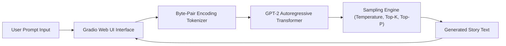

<p align="center">
  
</p>

<p align="center">
  
  
  
  
  
</p>

---

## Executive Summary / Overview
### Problem Statement & Context
Large Language Models exhibit powerful causal completion capabilities, but raw command-line text generation is inaccessible to non-technical stakeholders. Providing an intuitive interface that exposes decoding parameters—such as Temperature, Top-K, and Top-P (Nucleus) sampling—is essential for evaluating creative generation fidelity and hallucinations.

### Solution Overview
This repository implements an **Interactive Story and Creative Text Generation Engine** powered by the **OpenAI GPT-2 causal language model**. Delivered via a clean, web-based **Gradio application**, the system allows users to provide an initial story prompt and dynamically tune sampling hyperparameters to produce cohesive, creative narratives in real time.

---

## Interactive Table of Contents
- [Executive Summary / Overview](#executive-summary--overview)
- [Key Features & Capabilities](#key-features--capabilities)
- [System Architecture / Pipeline](#system-architecture--pipeline)
- [Tech Stack Breakdown](#tech-stack-breakdown)
- [Reproducible Quickstart & Setup](#reproducible-quickstart--setup)
- [Project Directory Layout](#project-directory-layout)
- [Author & Contributions](#author--contributions)

---

## Key Features & Capabilities
- **Autoregressive Causal Generation:** Leverages pre-trained and fine-tuned GPT-2 weights via `AutoModelForCausalLM`.
- **Granular Decoding Control:** Real-time user sliders for Temperature (randomness), Top-K filtering, and Top-P (Nucleus) sampling.
- **Interactive Gradio Interface:** Clean, reactive web UI enabling zero-friction prompt submission and live text rendering.
- **Context Preservation:** Enforces max token lengths and repetition penalties to prevent degenerative repetitive loops.

---

## System Architecture / Pipeline


---

## Tech Stack Breakdown
| Layer | Technology | Purpose |
| :--- | :--- | :--- |
| **Languages** | Python 3.10+ | Primary application runtime |
| **Libraries** | Hugging Face `transformers`, PyTorch | GPT-2 language model weights, tokenization, CUDA acceleration |
| **Tools** | Gradio, Jupyter Notebook | Reactive web GUI for parameter control and interactive prototyping |
| **Architecture** | Autoregressive Transformer Inference | Causal self-attention with nucleus/temperature sampling |

---

## Reproducible Quickstart & Setup
```bash
# 1. Clone repository
git clone https://github.com/suryateja-155/GEN-AI-Test.git
cd GEN-AI-Test

# 2. Virtual environment setup
python -m venv venv
.\venv\Scripts\activate   # On Windows

# 3. Install dependencies
pip install torch transformers gradio notebook

# 4. Launch the application
jupyter notebook "GPT_2_Interactive_Story_Generator.ipynb"
```

---

## Project Directory Layout
```text
GEN-AI-Test/
├── GPT_2_Interactive_Story_Generator.ipynb   # Complete Gradio web app & GPT-2 generation logic
└── README.md                                 # Technical architecture, sampling guide and usage
```

---

## Author & Contributions

**Gettupalli Surya Teja**  
- GitHub Profile: [@suryateja-155](https://github.com/suryateja-155)  
- Portfolio Index: [Gettupalli-Surya-Teja](https://github.com/suryateja-155/Gettupalli-Surya-Teja)

Contributions, issue reports, and feedback are always welcome! Feel free to open an issue or pull request.

<p align="center">
  
</p>
